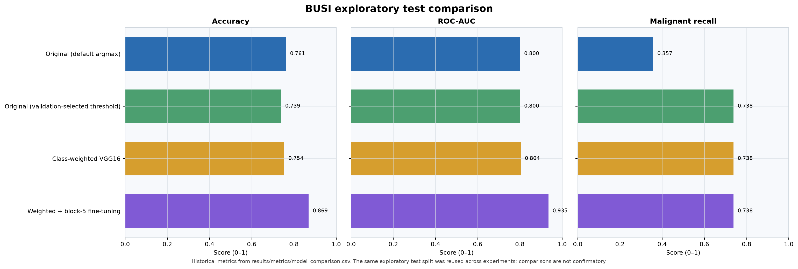
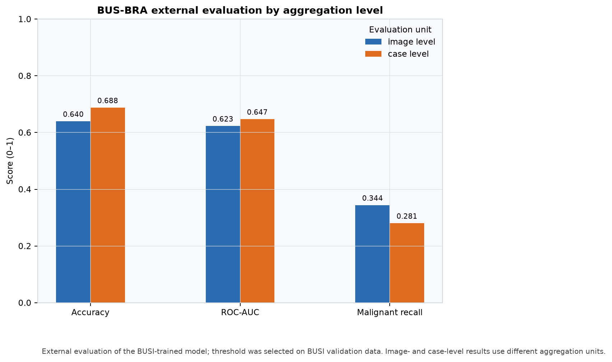
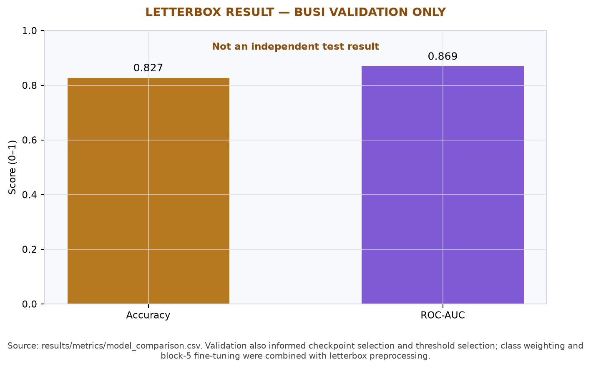

# Breast Cancer Detection Using VGG16

[](https://github.com/bhargavsrikar-5/Breast-Cancer-Detection-VGG16/actions/workflows/ci.yml)

An academic research software project for binary benign/malignant classification of breast ultrasound images using transfer learning with VGG16. It provides a paper-faithful baseline, clearly separated experiments, a no-training Colab runtime check, and BUS-BRA external evaluation utilities.

> **Research software only.** This project is not a medical device and is not intended for diagnosis, screening, treatment decisions, or patient care. The experiments are retrospective, small, and not clinically validated.

## At a glance

- **Problem:** classify BUSI ultrasound images as benign or malignant; the baseline excludes the `normal_scan` class.
- **Why VGG16:** the research project is based on a transfer-learning VGG16 method using ImageNet features and a compact binary classification head.
- **Technology:** Python, TensorFlow/Keras, OpenCV, NumPy, scikit-learn, Matplotlib, and Jupyter/Google Colab.
- **Reproducibility:** shared source modules, explicit experiment settings, stratified split metadata, run-specific metrics, and lightweight static CI.
- **Privacy:** datasets, medical images, checkpoints, and training outputs are not included.

## Architecture

The baseline loads BUSI images as grayscale, resizes directly to 224 × 224, scales values to `[0, 1]`, repeats grayscale into three channels, and feeds a frozen ImageNet VGG16 backbone followed by GlobalAveragePooling2D, Dense(256, ReLU), Dropout(0.5), and Dense(2, softmax).

See [the architecture and experiment map](docs/architecture.md) for the Mermaid diagram and the boundary between the baseline and its extensions.

## Baseline and separate experiments

The baseline follows the paper-faithful configuration described in the project: benign and malignant BUSI classes only, grayscale repeated across channels, direct resize, `/255` normalization, frozen VGG16 convolutional layers, and no augmentation, class weighting, letterbox preprocessing, or fine-tuning. The experiment code uses Adam at `1e-4`, categorical cross-entropy, batch size 16, up to 20 epochs, early stopping, and a checkpoint selected by validation loss.

Extensions are separate workflows and do not redefine the baseline:

- **Augmentation:** horizontal flips, small rotations, and zoom; applied only during training.
- **Class weighting:** balanced weights computed from the training partition.
- **Block-5 fine-tuning:** a second stage at learning rate `1e-5` after frozen-backbone training.
- **Letterbox:** aspect-ratio-preserving resize with centered padding. Its recorded result also used class weighting and fine-tuning, so it does not isolate the padding change.
- **BUS-BRA:** external evaluation of a BUSI-trained model. The decision threshold is sourced from BUSI validation data and is not tuned on BUS-BRA.

## Recorded results

Values below are historical records, not results regenerated by CI. BUSI test metrics are exploratory because the same test split was reused across experiments. The paper-reported ROC-AUC of **0.67** is separate from the notebook-measured baseline ROC-AUC of **0.8003**.

| Experiment | Evaluation split | Accuracy | ROC-AUC | Malignant recall |
|---|---|---:|---:|---:|
| Original VGG16, default argmax | BUSI exploratory test | 76.15% | 0.8003 | 35.71% |
| Original VGG16, validation-selected threshold | BUSI exploratory test | 73.85% | 0.8003 | 73.81% |
| Class-weighted VGG16 | BUSI exploratory test | 75.38% | 0.8036 | 73.81% |
| Class-weighted VGG16 with block-5 fine-tuning | BUSI exploratory test | 86.92% | 0.9351 | 73.81% |
| Fine-tuned BUSI model | BUS-BRA image level | 64.00% | 0.6232 | 34.43% |
| Fine-tuned BUSI model | BUS-BRA case level | 68.80% | 0.6475 | 28.07% |
| Letterbox + class weighting + fine-tuning | BUSI validation only | 82.69% | 0.8689 | Not recorded |

The fine-tuned experiment's **93.98% is training accuracy**, not test accuracy; its historical BUSI test accuracy is **86.92%**. The letterbox result is validation-only. The BUSI image-level split may place related images across partitions. BUS-BRA results are external dataset measurements and show weaker generalization. See the [full machine-readable metrics](results/metrics/model_comparison.csv) and [experimental findings and caveats](docs/experimental_findings.md).

### Visual summaries

These figures are generated from `results/metrics/model_comparison.csv` by [`scripts/generate_result_figures.py`](scripts/generate_result_figures.py). They do not add, refit, or recompute model predictions.

**BUSI exploratory test experiments** — the reused exploratory split is labeled in the figure.



**BUS-BRA external evaluation** — image-level and case-level aggregation are shown separately.



**Letterbox preprocessing** — validation-only result; not an independent test evaluation.



## Dataset and citations

Datasets are not bundled. Obtain them from their authoritative sources and review their current terms before use. Keep images, masks, and patient information outside this repository.

- **BUSI:** 780 images in the original three-class dataset; this binary workflow uses 437 benign and 210 malignant images. Al-Dhabyani W, Gomaa M, Khaled H, Fahmy A. “Dataset of breast ultrasound images.” *Data in Brief*. 2020;28:104863. [doi:10.1016/j.dib.2019.104863](https://doi.org/10.1016/j.dib.2019.104863).
- **BUS-BRA:** 1,875 images from 1,064 cases, used here only for external evaluation. Gómez-Flores W, Gregorio-Calas MJ, Coelho de Albuquerque Pereira W. “BUS-BRA: A breast ultrasound dataset for assessing computer-aided diagnosis systems.” *Medical Physics*. 2024;51:3110–3123. [doi:10.1002/mp.16812](https://doi.org/10.1002/mp.16812). [Dataset record](https://doi.org/10.5281/zenodo.8231412).

The project notes report that the BUSI ZIP used historically did not contain separate mask files. Classification does not use masks; confirm the exact release before making claims about mask availability. More details are in [dataset documentation](docs/dataset_documentation.md).

### Research paper and software authorship

The research paper authors are Kummari Vishnu, Chegu Bhargav Srikar, and Pagalla Ashok; their published authorship is documented in [the paper methodology notes](docs/paper_methodology.md). The software developer, author, and maintainer for this repository is **Chegu Bhargav Srikar**. Use [`CITATION.cff`](CITATION.cff) to cite this software. The paper and software are distinct citation targets. No DOI, software release, or code license is claimed.

## Quickstart

Use Python 3.10–3.12. Create a virtual environment, install the project requirements, then run an experiment only when you intend to train:

```bash
python -m venv .venv
# Windows: .venv\Scripts\activate
# macOS/Linux: source .venv/bin/activate
python -m pip install --upgrade pip
python -m pip install -r requirements.txt
```

The lightweight static suite does not require TensorFlow. Run it from the repository root:

```bash
python -m unittest discover -s tests -v
python -m compileall -q src tests scripts
```

For lint and formatting checks, install the pinned development tool and run:

```bash
python -m pip install -r requirements-dev.txt
ruff check src tests scripts
ruff format --check src tests scripts
```

These checks parse notebook JSON and Python code cells without executing notebooks. Static CI does not train models, evaluate datasets, verify model accuracy, or establish clinical performance.

## Single-image inference

Use `src.predict` to load a locally saved Keras checkpoint and classify one ultrasound image. Inference reuses the project preprocessing pipeline and runs on CPU; it does not train or fine-tune a model. Install the project prerequisites with `python -m pip install -r requirements.txt`, then run from the repository root:

```bash
python -m src.predict --model results/runs/<run-name>/best_model.keras --image /path/to/ultrasound.png
```

Argmax is the default decision. Optionally pass either `--threshold 0.42` or the checkpoint run's adjacent `--metrics-json results/runs/<run-name>/metrics.json` to use a BUSI validation-selected threshold. Save structured output with `--output-json prediction.json`. Example JSON (illustrative values only):

```json
{
  "predicted_class": "benign",
  "confidence": 0.82,
  "probabilities": {"benign": 0.82, "malignant": 0.18},
  "decision_method": "Argmax",
  "threshold": null,
  "threshold_source": "Argmax (no threshold supplied)",
  "model_path": "/local/path/best_model.keras",
  "image_path": "/local/path/ultrasound.png"
}
```

See the full [single-image inference guide](docs/inference.md) for local and Colab usage, threshold provenance, and limitations. A genuine checkpoint inference has not yet been independently runtime-verified. Predictions are research outputs only, not medical diagnoses, and must not guide screening or treatment decisions.

## Notebook execution order

1. [`00_runtime_smoke_test.ipynb`](notebooks/00_runtime_smoke_test.ipynb) checks runtime imports and configured data paths with no training. Requirements installation and model-weight fetching are explicit opt-ins.
2. [`01_paper_reproduction.ipynb`](notebooks/01_paper_reproduction.ipynb) inspects the baseline dataset and split; training is disabled unless explicitly enabled.
3. [`02_data_augmentation.ipynb`](notebooks/02_data_augmentation.ipynb) runs the training-only augmentation extension when explicitly enabled.
4. [`03_model_improvements.ipynb`](notebooks/03_model_improvements.ipynb) selects class weighting, block-5 fine-tuning, or letterbox experiments.
5. [`04_external_validation.ipynb`](notebooks/04_external_validation.ipynb) evaluates an existing BUSI checkpoint on BUS-BRA and requires its matching BUSI validation threshold provenance.

For a local checkout, BUSI can be arranged as `data/BUSI/benign_tumor/`, `data/BUSI/malignant_tumor/`, and `data/BUSI/normal_scan/`. The `data/` directory is ignored. Set `BUSI_ROOT` or pass `--data-root` to use another location. For Colab setup and output paths, follow the smoke-test notebook and keep datasets outside the repository.

Training is an explicit CLI command and writes to a new UTC timestamped run folder:

```bash
python -m src.train --experiment baseline --data-root "D:/datasets/BUSI" --output-root "D:/busi-runs"
```

Available experiments are `baseline`, `augmentation`, `class_weighted`, `finetuned`, and `letterbox`. For external evaluation, supply the selected model's adjacent `metrics.json`; legacy thresholds must be explicitly supplied and verified as selected on BUSI validation data. BUS-BRA must not be used for training or threshold selection.

## Repository structure

```text
.github/             Lightweight CI and dependency update configuration
docs/                Methodology, architecture, results, dataset, and licensing notes
notebooks/           Smoke test and four clean research workflow notebooks
results/figures/     Reproducible plots generated from the historical metrics CSV
results/metrics/     Historical comparison table; no models or datasets
scripts/             Metrics-based result figure generator
src/                 Reusable configuration, preprocessing, model, training, evaluation
tests/               Dependency-light structural and research-result regression checks
```

The original root Colab notebook and its archived byte-identical copy are retained locally but intentionally excluded from the public repository because their outputs include scan imagery. Local paper and resume PDFs are also excluded. See `.gitignore` for publication exclusions.

## Limitations and responsible use

- Repeated use of the BUSI test split makes its recorded results exploratory; a confirmatory study needs an untouched test set or a grouped/nested evaluation design.
- The current BUSI split is image-level, not lesion- or patient-grouped, so related views may cross splits.
- BUS-BRA results show a cross-dataset generalization challenge and are not clinical validation.
- Letterbox metrics are validation-only and confounded with class weighting and fine-tuning.
- The historical BUSI archive and exact mask availability should be checked against the specific dataset release used.
- This work is not a prospective clinical study and must not guide individual diagnosis or treatment.
- Dataset terms are independent of software terms. No `LICENSE` is included until the authors confirm authority to license the code.

## Contributing and security

See [contribution and validation guidance](CONTRIBUTING.md) and [security and sensitive-data reporting](SECURITY.md). Never commit datasets, scan images, personal health information, credentials, model checkpoints, or temporary run outputs.
