# Project architecture

## Paper-faithful binary baseline

The baseline classifies BUSI benign and malignant ultrasound images. The `normal_scan` class is excluded. The core path follows the paper description implemented in this repository: grayscale loading, direct 224 × 224 resize, repeated grayscale values across three channels, division by 255, a frozen ImageNet VGG16 convolutional base, and a compact binary classification head.

```mermaid
flowchart LR
    A[BUSI folders<br/>benign_tumor / malignant_tumor / normal_scan] --> B[Class discovery<br/>include benign + malignant only]
    B --> C[OpenCV grayscale load<br/>exclude mask files]
    C --> D[Direct resize to 224 × 224]
    D --> E[Repeat grayscale into<br/>three identical channels]
    E --> F[Normalize to 0–1<br/>TensorFlow data pipeline<br/>one-hot labels + batches]
    F --> G[VGG16 ImageNet backbone<br/>include_top=false, frozen]
    G --> H[GlobalAveragePooling2D]
    H --> I[Dense 256, ReLU]
    I --> J[Dropout 0.5]
    J --> K[Dense 2, Softmax]
    K --> L[BUSI validation/test evaluation<br/>metrics + saved run metadata]

    F -. training-only branch .-> M[Optional data augmentation]
    M -. training only .-> G
    F -. training labels only .-> N[Optional class weighting]
    N -. training loss weights .-> G
    G -. second-stage extension .-> O[Optional block-5 fine-tuning<br/>lower learning rate]
    O --> H
    C -. alternative preprocessing .-> P[Optional letterbox<br/>aspect ratio + padding]
    P --> E
    L -. saved BUSI model + BUSI validation threshold .-> Q[BUS-BRA external evaluation<br/>image and case level]
```

## Baseline and extensions

| Component | Paper-faithful baseline | Separate extension |
|---|---|---|
| BUSI classes | Benign and malignant; normal excluded | Same binary classes |
| Input | Grayscale, direct resize, `/255`, repeated RGB channels | Letterbox replaces direct resize only in its named experiment |
| Backbone | ImageNet VGG16 without its classifier top; all convolutional layers frozen | Block 5 is unfrozen only in the explicit fine-tuning workflow |
| Classification head | Global average pooling, Dense(256, ReLU), Dropout(0.5), Dense(2, softmax) | Same head |
| Optimization | Adam at 1e-4, categorical cross-entropy | Fine-tuning stage uses 1e-5 |
| Augmentation / class weights | Disabled | Applied only to training data / computed from training labels |
| External data | None | BUS-BRA is evaluation-only; threshold comes from BUSI validation |

The historical letterbox result also used class weighting and block-5 fine-tuning and was recorded on BUSI validation only. It does not isolate the effect of letterboxing and must not be presented as an independent test result. BUSI test results are exploratory because the same test split was reused across experiments. Image-level splitting may allow related images to cross partitions.

## Implementation map

- `src/preprocessing.py`: BUSI class discovery, image transforms, deterministic split creation, and TensorFlow input pipeline.
- `src/model.py`: VGG16 backbone and classification head with opt-in augmentation and block-5 fine-tuning settings.
- `src/train.py`: explicit experiment execution, checkpoints, validation threshold selection, and run metrics.
- `src/evaluate.py`: checkpoint-matched BUSI validation threshold resolution and BUS-BRA image/case evaluation.
- `notebooks/00_runtime_smoke_test.ipynb`: no-training runtime and compatibility checks.
- `results/metrics/model_comparison.csv`: historical metrics used by the results figures.
